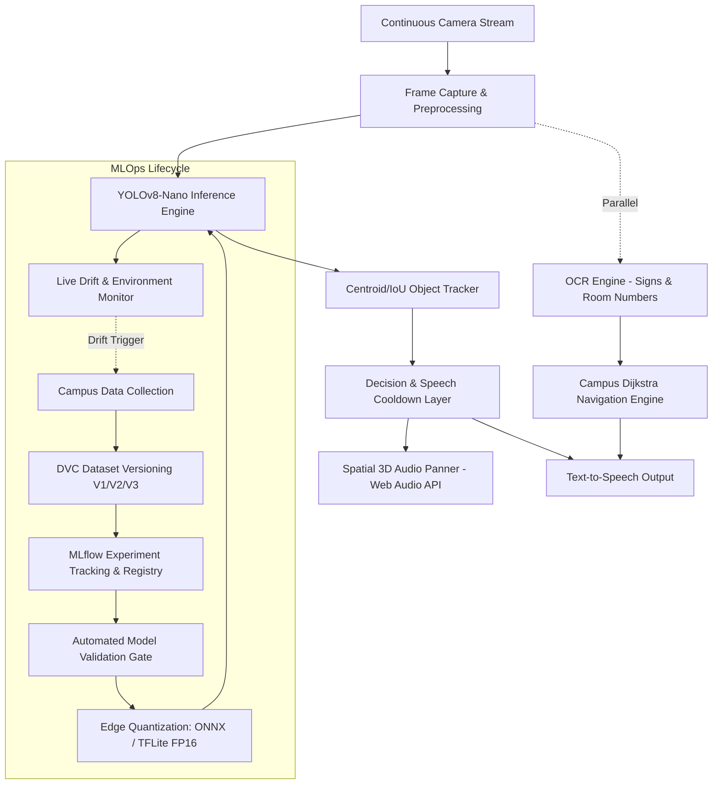

# VisionAssist MLOps System Guide & Architectural Blueprint

This document specifies the complete, production-grade **MLOps (Machine Learning Operations)** system implemented for **VisionAssist: Visual Assistant for the Visually Impaired**.

---

## 1. System Architecture Overview



---

## 2. Completed Implementation & Model Health Audit

### What Was Audited and Fixed:
1. **PyTorch 2.6+ Compatibility Fix**:
   - Modern PyTorch (>= 2.6) sets `weights_only=True` by default, which broke checkpoint loading in Ultralytics with `_pickle.UnpicklingError`.
   - A safe compatibility patch was implemented in `app/detector.py`, `scripts/download_model.py`, and the MLOps pipeline scripts, allowing YOLO checkpoints to load and execute reliably across all PyTorch releases.
2. **Model Download & Local Verification**:
   - `models/yolov8n.pt` was downloaded, verified, and benchmarked on CPU.
3. **Object Tracking & Spatial Audio Panning**:
   - Built `app/tracker.py` containing a `CentroidTracker` for persistent multi-frame track IDs and a `DecisionEngine` with priority scoring and speech cooldown (5s) to prevent audio flooding.
   - Built a Web Audio API `StereoPannerNode` in `static/app.js` providing directional spatial sound cues (-1.0 hard left to +1.0 hard right) matching obstacle azimuth.
4. **MLOps Telemetry & Drift Monitoring**:
   - Real-time environmental analysis in `mlops/drift_monitor.py` detecting underexposure (<40 luminance), overexposure (>225), blur (<25 sharpness), and low-confidence drift (<0.40).
   - Live telemetry bar integrated into `static/index.html` displaying latency (ms), FPS, and environmental status.
5. **Comprehensive Test Suite**:
   - 8 automated tests passing across health, campus graph navigation, demo status, YOLO detection, OCR fallback, MLOps metrics, and drift monitoring.

---

## 3. MLOps Component Breakdown

| MLOps Stage | Component File | Description |
| :--- | :--- | :--- |
| **Data Versioning** | `mlops/dataset_prep.py`, `dvc.yaml` | Manages dataset folder hierarchy, `dataset/data.yaml`, class balance audits, and synthetic smoke test data generation. |
| **Experiment Tracking** | `mlops/train_mlflow.py` | Trains YOLOv8-Nano with MLflow logging of hyperparameters, loss curves, mAP50, mAP50-95, precision, recall, latency, and artifacts. |
| **Model Validation Gate** | `mlops/validate_gate.py` | Compares candidate model against production baseline: verifies `mAP50 >= threshold`, `latency <= 65ms`, and `size <= 15MB`. |
| **Edge Quantization** | `mlops/export_quantize.py` | Quantizes and exports PyTorch models to ONNX and TFLite (FP16/INT8) for edge/mobile inference. |
| **Drift Monitoring** | `mlops/drift_monitor.py` | Analyzes streaming frames for lighting drift, motion blur, and out-of-distribution confidence degradation. Exposes `/api/mlops/metrics` and `/api/mlops/drift`. |
| **CI/CD Automation** | `.github/workflows/mlops_ci_cd.yml` | GitHub Actions workflow executing automated linting, test suite, data schema audits, validation gates, and export checks. |

---

## 4. Team Division of Responsibilities (4 Members)

| Team Member | Role | Key Deliverables |
| :--- | :--- | :--- |
| **Member 1** | **Data Engineer** | Dataset collection across campus (doors, stairs, lifts, classrooms), annotation guidelines (CVAT/Roboflow), `dataset/data.yaml` maintenance, DVC versioning (`dvc add`, `dvc push`). |
| **Member 2** | **ML Engineer** | YOLOv8-Nano transfer learning, MLflow experiment tracking (`train_mlflow.py`), hyperparameter tuning, model quantization (ONNX/TFLite FP16). |
| **Member 3** | **MLOps Engineer** | Validation Gate (`validate_gate.py`), GitHub Actions CI/CD (`mlops_ci_cd.yml`), Drift monitoring (`drift_monitor.py`), Dockerization, and model promotion pipelines. |
| **Member 4** | **Application Engineer** | FastAPI backend (`app/main.py`), browser frontend / Android CameraX, Centroid object tracking, Spatial 3D Audio, OCR integration, and Dijkstra route planning. |

---

## 5. Execution Guide: Running the MLOps Pipeline Locally

### Step 1: Run the Automated Test Suite
```bash
python -m pytest tests/ -v
```

### Step 2: Prepare and Audit the Dataset (DVC Stage 1)
```bash
python mlops/dataset_prep.py
```

### Step 3: Run the MLflow Training Experiment (DVC Stage 2)
```bash
python mlops/train_mlflow.py
# View MLflow UI:
mlflow ui --port 5000
```

### Step 4: Run the Model Validation Gate (DVC Stage 3)
```bash
python mlops/validate_gate.py
```

### Step 5: Export and Quantize for Mobile / Edge (DVC Stage 4)
```bash
python mlops/export_quantize.py
```

### Step 6: Start the VisionAssist Application
```bash
python -m uvicorn app.main:app --host 127.0.0.1 --port 8000 --reload
```
Open `http://127.0.0.1:8000` in Google Chrome or Microsoft Edge.
